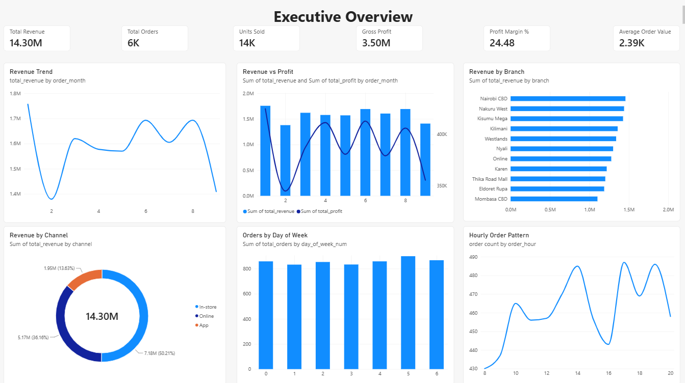
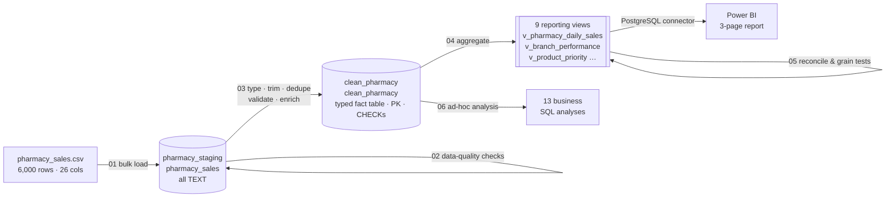
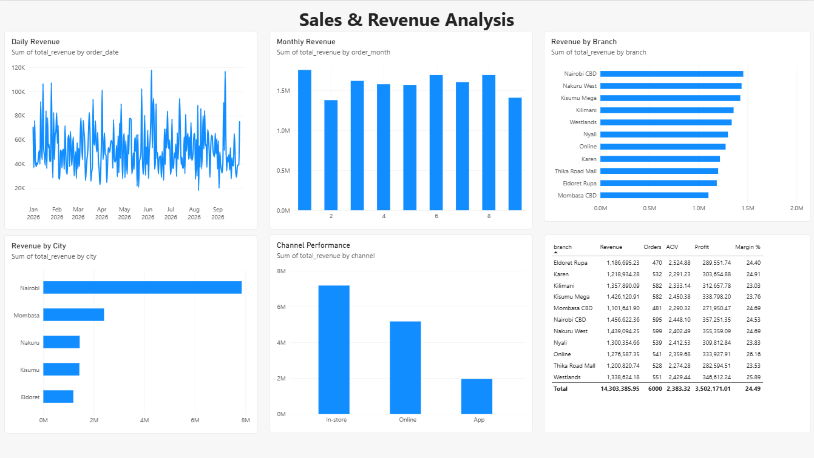
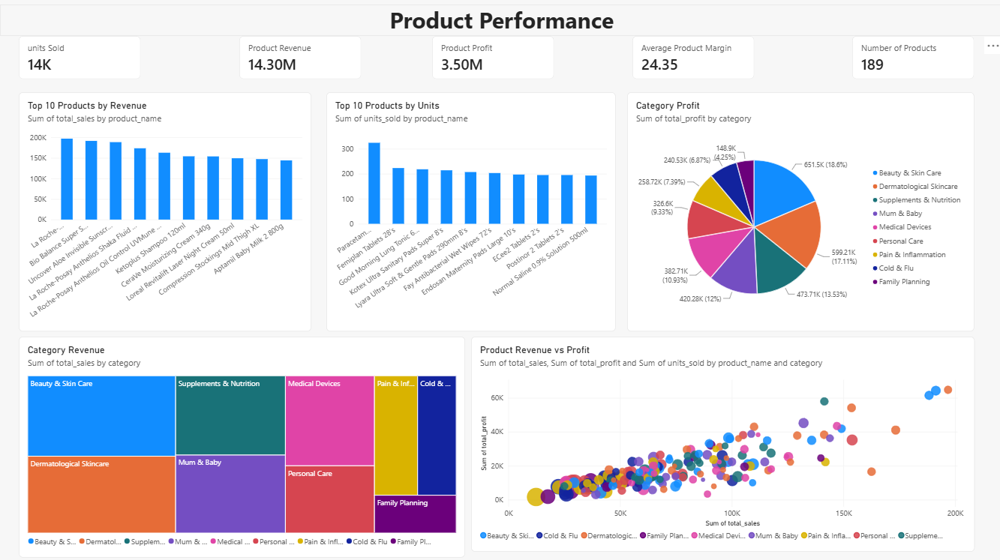

# Pharmacy Sales Analytics: PostgreSQL → Power BI

**End-to-end retail pharmacy analytics, from a raw CSV to an executive dashboard.**
A layered PostgreSQL warehouse (staging → clean → semantic views), tested with SQL reconciliation checks, feeds a three-page Power BI report covering revenue, branch, channel and product performance for a multi-branch Kenyan pharmacy chain.




---

## Table of contents

1. [Project at a glance](#1-project-at-a-glance)
2. [Business problem](#2-business-problem)
3. [Architecture](#3-architecture)
4. [Dataset](#4-dataset)
5. [SQL pipeline, step by step](#5-sql-pipeline-step-by-step)
6. [Semantic layer: the 9 reporting views](#6-semantic-layer-the-9-reporting-views)
7. [Testing and reconciliation](#7-testing-and-reconciliation)
8. [Power BI report](#8-power-bi-report)
9. [Key findings](#9-key-findings)
10. [Recommendations](#10-recommendations)
11. [Repository structure](#11-repository-structure)
12. [How to reproduce](#12-how-to-reproduce)
13. [Skills demonstrated](#13-skills-demonstrated)
14. [Limitations and next steps](#14-limitations-and-next-steps)
15. [Author](#15-author)

---

## 1. Project at a glance

| | |
|---|---|
| **Scope** | 6,000 order lines · 1,724 customers · 189 products · 9 categories · 11 branches · 5 cities · 3 channels |
| **Period** | 1 January – 30 September 2026 (273 trading days) |
| **Stack** | PostgreSQL 16 (Aiven cloud) · SQL · Power BI Desktop (PostgreSQL connector) |
| **Layers** | `pharmacy_staging` (raw) → `clean_pharmacy` (typed fact table + 9 views) → Power BI |
| **Quality gate** | 8 groups of data-quality checks (30+ individual tests) before cleaning; 15 reconciliation and grain tests after (all pass) |
| **Output** | 3-page interactive dashboard plus 13 standalone SQL analyses |

### Headline KPIs

| Revenue | Orders | Units | Gross profit | Margin | Avg. order value |
|:---:|:---:|:---:|:---:|:---:|:---:|
| **KES 14.30 M** | **6,000** | **14,059** | **KES 3.50 M** | **24.48 %** | **KES 2,383.90** |

---

## 2. Business problem

A pharmacy chain operating in Nairobi, Mombasa, Nakuru, Kisumu and Eldoret sells through three channels: walk-in stores, a website and a mobile app. Management had transaction data but no single, trusted view of performance. The project set out to answer:

1. **How is the business trending?** Revenue, profit and margin by day and month.
2. **Where is revenue coming from?** Branch, city and channel contribution.
3. **Which products and categories drive revenue and profit,** and which need action?
4. **When do customers buy?** Day-of-week and hour-of-day demand, for staffing and replenishment.
5. **Where is margin leaking?** The effect of discounting and loss-making sales.

Every number in the dashboard had to be traceable to SQL and reconcile exactly with the raw data.

---

## 3. Architecture



**Design principles**

- **Separate layers.** Raw data lands untouched in `pharmacy_staging`, with every column stored as `TEXT` so a malformed value can never block or silently distort a load. All typing and business rules live in one place (`03_clean_transform.sql`).
- **Business logic in SQL, presentation in Power BI.** KPIs are computed once in the views with one consistent definition, so the dashboard, ad-hoc SQL and any future tool all report the same number.
- **Pre-aggregated views at the grain each visual needs.** Power BI imports 273 daily rows instead of 6,000 lines for trend charts, which keeps the model small and fast.
- **Test before you trust.** Every view is reconciled back to the fact table to the cent before it reaches a report.
- **Cloud-hosted database.** PostgreSQL runs on Aiven, so the report connects to a live managed database rather than a local file.

---

## 4. Dataset

`data/raw/pharmacy_sales.csv` holds one row per order line with 26 columns covering the transaction, customer, location, product, pricing, payment and rating. The full column-by-column reference is in **[docs/data_dictionary.md](docs/data_dictionary.md)**.

| Group | Columns |
|---|---|
| Transaction | `order_id`, `order_date`, `order_time`, `quantity`, `discount_pct` |
| Customer | `customer_id`, `customer_gender`, `customer_age`, `customer_rating` |
| Location / channel | `city`, `branch`, `channel` |
| Product | `product_id`, `product_name`, `brand`, `category`, `subcategory`, `dosage_form`, `requires_prescription` |
| Money (KES) | `list_price_kes`, `unit_price_kes`, `unit_cost_kes`, `total_amount_kes`, `delivery_fee_kes`, `gross_profit_kes` |
| Payment | `payment_method` (M-Pesa, Card, Cash, Insurance) |

**Revenue definition.** Revenue is `total_amount_kes`, the net line value after discount. Delivery fees (KES 461,850 in total, charged only on Online and App orders) are a pass-through charge and are **excluded** from revenue and margin.

---

## 5. SQL pipeline, step by step

All scripts are in [`sql/`](sql/) and run in numeric order.

| Step | Script | What it does |
|---|---|---|
| 0 | [`00_create_schemas.sql`](sql/00_create_schemas.sql) | Creates the `pharmacy_staging` and `clean_pharmacy` schemas |
| 1 | [`01_staging_load.sql`](sql/01_staging_load.sql) | Creates an all-`TEXT` landing table and bulk-loads the CSV with `\copy` |
| 2 | [`02_data_quality_checks.sql`](sql/02_data_quality_checks.sql) | Profiles the raw data: volume, duplicates, nulls, type conformance, domains, ranges, arithmetic, master-data consistency |
| 3 | [`03_clean_transform.sql`](sql/03_clean_transform.sql) | Builds the typed, de-duplicated, validated and enriched fact table with PK, `CHECK` constraints and indexes |
| 4 | [`04_analytics_views.sql`](sql/04_analytics_views.sql) | Builds the 9 reporting views (the semantic layer) |
| 5 | [`05_view_validation.sql`](sql/05_view_validation.sql) | Smoke tests, reconciliation tests and grain tests on every view |
| 6 | [`06_business_analysis.sql`](sql/06_business_analysis.sql) | 13 business analyses (Q1–Q13) using window functions, Pareto, RFM, pivots |

### 5.1 Staging load

```sql
CREATE TABLE pharmacy_staging.pharmacy_sales (
    order_id TEXT, order_date TEXT, ... , customer_rating TEXT,
    loaded_at TIMESTAMPTZ DEFAULT now()        -- load audit column
);
\copy pharmacy_sales (...) FROM 'data/raw/pharmacy_sales.csv' WITH (FORMAT csv, HEADER true, NULL '')
```

`\copy` streams the file from the client, so the same script works against a local server and against managed PostgreSQL (Aiven), where server-side `COPY` from a file path is not allowed.

### 5.2 Data-quality profiling: what the checks found

| Check | Finding | Decision |
|---|---|---|
| Duplicate `order_id` / exact duplicates | 0 / 0 | Keep de-dup logic anyway (`ROW_NUMBER`) so reloads stay safe |
| Missing values | Only `customer_rating` (1,546 rows, **25.8 %**) | Keep `NULL`. Imputing would inflate or deflate every rating KPI |
| Type conformance | 0 bad dates, times, numbers or booleans | Safe to cast |
| Business ranges | 0 out-of-range qty, price, cost, discount, age, rating | Bad qty/price/cost/discount rows are filtered in `03`; qty, discount and rating are also enforced with `CHECK` constraints |
| Revenue arithmetic `price × qty × (1 − disc)` | 0 mismatches | Source totals trusted |
| Profit arithmetic `revenue − cost × qty` | 0 mismatches | Source profit trusted |
| Loss-making lines | **203** | Kept: they are real business events, analysed in Q6–Q7 |
| Product → name/category, branch → city | 0 conflicts | Hierarchies are clean |
| Customer → gender/age/city | **1,530 customers carry conflicting values** | Demographics are captured per transaction. The customer view uses each customer's most recent order |

### 5.3 Cleaning and enrichment

```sql
CREATE TABLE clean_pharmacy.clean_pharmacy AS
WITH typed AS (
    SELECT TRIM(order_id) AS order_id,
           TRIM(order_date)::DATE AS order_date,
           TRIM(order_time)::TIME AS order_time,
           INITCAP(TRIM(customer_gender)) AS customer_gender,
           LOWER(TRIM(requires_prescription))::BOOLEAN AS requires_prescription,
           TRIM(total_amount_kes)::NUMERIC(12,2) AS total_amount_kes,
           NULLIF(TRIM(customer_rating), '')::NUMERIC(2,1) AS customer_rating,
           ROW_NUMBER() OVER (PARTITION BY TRIM(order_id) ORDER BY loaded_at) AS rn,
           ...
    FROM pharmacy_staging.pharmacy_sales
)
SELECT ...,
       EXTRACT(MONTH FROM order_date)::INT              AS order_month,
       EXTRACT(DOW   FROM order_date)::INT              AS day_of_week_num,
       EXTRACT(HOUR  FROM order_time)::INT              AS order_hour,
       ROUND(100 * gross_profit_kes / NULLIF(total_amount_kes, 0), 2) AS profit_margin_pct
FROM typed
WHERE rn = 1 AND quantity > 0 AND unit_price_kes > 0 AND unit_cost_kes > 0
  AND discount_pct BETWEEN 0 AND 100;

ALTER TABLE clean_pharmacy ADD PRIMARY KEY (order_id);
```

Seven derived columns (`order_year`, `order_month`, `order_month_name`, `day_of_week_num`, `day_of_week`, `order_hour`, `profit_margin_pct`) give Power BI everything it needs for time analysis without a separate date table. A closing reconciliation confirms **6,000 rows in, 6,000 rows out, KES 14,303,385.95 in both layers**.

---

## 6. Semantic layer: the 9 reporting views

Every view uses the **same KPI formulas**, so totals agree across every page:

| KPI | Definition |
|---|---|
| `total_orders` | `COUNT(DISTINCT order_id)` |
| `units_sold` | `SUM(quantity)` |
| `total_revenue` / `total_sales` | `SUM(total_amount_kes)` |
| `total_profit` | `SUM(gross_profit_kes)` |
| `profit_margin_pct` | `SUM(profit) / SUM(revenue) × 100`, a ratio of sums and never an average of line margins |
| `average_order_value` | `SUM(revenue) / COUNT(DISTINCT order_id)` |
| `average_rating` | `AVG(customer_rating)` over rated lines only |

| View | Grain | Feeds |
|---|---|---|
| `v_pharmacy_daily_sales` | 1 row per day (273) | Revenue trend, revenue vs profit, daily/monthly revenue, weekday orders, KPI cards |
| `v_branch_performance` | 1 row per branch (11) | Branch bar chart and branch scorecard table |
| `v_city_performance` | 1 row per city (5) | Revenue by city |
| `v_channel_performance` | 1 row per channel (3) | Channel donut and column chart |
| `v_category_performance` | 1 row per category (9) | Category revenue treemap, category profit pie |
| `v_product_performance` | 1 row per product (189) | Top-10 charts, revenue-vs-profit scatter |
| `v_product_branch_performance` | product × branch (1,841) | Branch revenue on the overview; assortment analysis |
| `v_customer_performance` | 1 row per customer (1,724) | Customer value analysis |
| `v_product_priority` | 1 row per product + action tag | Product action matrix (below) |

### Product priority matrix (`v_product_priority`)

The view turns product metrics into a management action. Products are split at the portfolio **median** revenue and **median** margin (medians resist the skew of a few high-value SKUs):

```sql
WITH product AS (...),
cutoffs AS (
    SELECT PERCENTILE_CONT(0.5) WITHIN GROUP (ORDER BY total_sales)       AS median_sales,
           PERCENTILE_CONT(0.5) WITHIN GROUP (ORDER BY profit_margin_pct) AS median_margin
    FROM product
)
SELECT p.*,
       CASE WHEN p.total_sales >= c.median_sales AND p.profit_margin_pct >= c.median_margin
                 THEN 'Star - protect & grow'
            WHEN p.total_sales >= c.median_sales THEN 'Volume driver - review pricing'
            WHEN p.profit_margin_pct >= c.median_margin THEN 'Niche - promote'
            ELSE 'Underperformer - review range' END AS management_priority
FROM product p CROSS JOIN cutoffs c;
```

| Priority | Products | Revenue share | Margin |
|---|---:|---:|---:|
| Star - protect & grow | 47 | 35.3 % | 31.40 % |
| Volume driver - review pricing | 48 | 34.0 % | 17.26 % |
| Niche - promote | 48 | 15.4 % | 30.92 % |
| Underperformer - review range | 46 | 15.3 % | 18.04 % |

---

## 7. Testing and reconciliation

[`05_view_validation.sql`](sql/05_view_validation.sql) runs three kinds of test. Current result: **all 15 checks pass.**

**Reconciliation:** every view must roll up to the fact table's revenue, profit and units.

| View | Revenue (KES) | Units | Status |
|---|---:|---:|:---:|
| v_branch_performance | 14,303,385.95 | 14,059 | ✅ PASS |
| v_category_performance | 14,303,385.95 | 14,059 | ✅ PASS |
| v_channel_performance | 14,303,385.95 | 14,059 | ✅ PASS |
| v_city_performance | 14,303,385.95 | 14,059 | ✅ PASS |
| v_customer_performance | 14,303,385.95 | 14,059 | ✅ PASS |
| v_pharmacy_daily_sales | 14,303,385.95 | 14,059 | ✅ PASS |
| v_product_branch_performance | 14,303,385.95 | 14,059 | ✅ PASS |
| v_product_performance | 14,303,385.95 | 14,059 | ✅ PASS |
| v_product_priority | 14,303,385.95 | 14,059 | ✅ PASS |

**Grain tests:** one row per date, branch, customer, product and product × branch, with every product tagged. These catch fan-out joins that would double-count in Power BI.

**Dashboard tie-out:** the branch scorecard in the report matches SQL to the cent (for example, Eldoret Rupa: KES 1,186,695.23 revenue, 470 orders, AOV 2,524.88, profit 289,551.74, margin 24.40 %).

---

## 8. Power BI report

The report ([`powerbi/PHARMACY_ANALYTICS.pbix`](powerbi/PHARMACY_ANALYTICS.pbix), PDF export: [`powerbi/PHARMACY_ANALYTICS.pdf`](powerbi/PHARMACY_ANALYTICS.pdf)) connects to the `clean_pharmacy` schema on Aiven PostgreSQL through Power BI's native PostgreSQL connector and loads the fact table plus all nine views. It also adds a DAX measure for the hourly pattern:

```DAX
order count = DISTINCTCOUNT('clean_pharmacy clean_pharmacy'[order_id])
```

### Page 1: Executive Overview


The one-screen health check for leadership.

| Visual | Source | Question answered |
|---|---|---|
| 6 KPI cards | `v_pharmacy_daily_sales` | Revenue, orders, units, profit, margin %, AOV |
| Revenue Trend (line) | `v_pharmacy_daily_sales` by month | Is revenue growing? |
| Revenue vs Profit (combo, dual axis) | `v_pharmacy_daily_sales` by month | Does profit move with revenue? |
| Revenue by Branch (bar) | `v_product_branch_performance` | Which branches lead? |
| Revenue by Channel (donut) | `v_channel_performance` | In-store vs Online vs App mix |
| Orders by Day of Week (column) | `v_pharmacy_daily_sales` | Which days are busiest? |
| Hourly Order Pattern (line) | `clean_pharmacy` + `order count` | When in the day do orders peak? |

### Page 2: Sales & Revenue Analysis



Drill-down into time and geography.

| Visual | Source | Question answered |
|---|---|---|
| Daily Revenue (line) | `v_pharmacy_daily_sales` | Day-level volatility and spikes |
| Monthly Revenue (column) | `v_pharmacy_daily_sales` | Month-on-month comparison |
| Revenue by Branch (bar) | `v_branch_performance` | Branch ranking |
| Revenue by City (bar) | `v_city_performance` | Geographic concentration |
| Channel Performance (column) | `v_channel_performance` | Channel contribution |
| Branch scorecard (table) | `v_branch_performance` | Revenue, orders, AOV, profit and margin per branch |

### Page 3: Product Performance



Assortment and category economics.

| Visual | Source | Question answered |
|---|---|---|
| 5 KPI cards | `v_product_performance` | Units, product revenue, profit, average product margin, product count (189) |
| Top 10 Products by Revenue | `v_product_performance` | Revenue leaders |
| Top 10 Products by Units | `v_product_performance` | Volume leaders (very different list) |
| Category Profit (pie) | `v_category_performance` | Where profit comes from |
| Category Revenue (treemap) | `v_category_performance` | Where revenue comes from |
| Product Revenue vs Profit (bubble scatter) | `v_product_performance` | Which products convert revenue into profit, sized by units and coloured by category |

---

## 9. Key findings

All figures come from the SQL in [`06_business_analysis.sql`](sql/06_business_analysis.sql) (query numbers in brackets).

### Revenue and trend
- **KES 14.30 M revenue and KES 3.50 M gross profit (24.48 % margin)** from 6,000 orders over nine months, with an average order value of **KES 2,383.90** [Q1].
- Revenue is **stable rather than growing**: monthly revenue stays between KES 1.38 M and 1.76 M. January is the peak (KES 1.76 M). February (−21.5 % MoM) and September (−16.8 %) are the weakest months [Q2].
- Order counts actually **rose from 574 in February to 757 in August**, while revenue stayed flat. Customers are buying more often but spending less per order.

### Branches, cities and channels
- Performance is **evenly spread across branches**: the top branch (Nairobi CBD, 10.2 %) and the bottom one (Mombasa CBD, 7.7 %) are only 2.5 points apart [Q3].
- **Nairobi generates 54.9 % of revenue** (KES 7.85 M across six branches: five stores plus Online). Mombasa is a distant second at KES 2.40 M.
- **Margin and revenue rankings disagree.** Online (26.16 %) and Westlands (25.89 %) earn the best margins. Kilimani, the #4 branch by revenue, has the **lowest margin (23.03 %)**. Eldoret Rupa has the highest AOV (KES 2,524.88) despite the lowest order count [Q3].
- **In-store dominates with 50.2 % of revenue** (KES 7.18 M). Online contributes 36.2 % and the App 13.6 %. Online and App orders carry a higher AOV (≈ KES 2,418 vs 2,351 in-store) [Q8].
- **M-Pesa handles 61.3 % of transactions** across every channel. Insurance pays for only 7.5 % [Q8].

### Products and categories
- **Beauty & Skin Care (KES 2.52 M) and Dermatological Skincare (KES 2.42 M) together make up 34.5 % of revenue** and the largest share of profit. Supplements & Nutrition is the third profit pool at a strong 25.68 % margin.
- **High-volume products are not the high-revenue products.** Paracetamol, Femiplan and sanitary pads top the units chart, while premium sun-care and serums (La Roche-Posay Anthelios, Bio Balance Vitamin C) top revenue.
- Revenue is **broad-based, not 80/20**: 119 of 189 products (63 %) are needed to reach 80 % of revenue [Q4]. The catalogue earns its keep, but there is no small set of hero SKUs to lean on.
- Some top sellers earn thin margins: **La Roche-Posay Anthelios Oil Control earns only 10.16 %** and Betadine Gargle 11.25 %, against a 24 % average [Q5].
- **Prescription (Rx) items make up just 6.3 % of revenue** at a lower margin (22.27 % vs 24.63 % OTC). This is an OTC/front-of-shop business [Q9].

### Discounting: the biggest lever
- Margin **falls step by step with discount depth**: 31.08 % at 0 % discount, 24.34 % at 10 %, 14.99 % at 20 % and **7.99 % at 25 %** [Q6].
- **Discounts do not buy volume.** Units per line are 2.37 at no discount and 2.29 at 25 % discount.
- **35.5 % of revenue (KES 5.08 M) is sold at 15 % discount or more, at a blended 15.0 % margin.**
- **All 203 loss-making lines sit at 15 % discount or more**, and 127 of them at 25 %. Medical Devices and Dermatological Skincare lose the most [Q6, Q7].

### Customers and timing
- **88.9 % of customers bought more than once** (3.48 orders on average, up to 11) [Q10].
- In the RFM segmentation, **"Champions" (25 % of customers) bring in 43.9 % of revenue**, and "Loyal - at risk" adds another 25.4 %, which together is almost 70 % of revenue from about 40 % of customers [Q10].
- **Demand is spread evenly through the trading day** (430–487 lines per hour). The **opening hours (08:00–09:59) are the quietest**, with mild peaks at **17:00, 19:00 and 14:00**. **Friday** is the busiest day (899 lines) and Monday the quietest (832) [Q11].
- **Female customers account for 64 % of revenue.** The 25–44 age group drives 63 % of revenue, while 55+ customers spend the most per line (KES 2,691) [Q13].

---

## 10. Recommendations

| # | Recommendation | Evidence |
|---|---|---|
| 1 | **Cap routine discounts at 10 %** and keep 15–25 % only for clearance or expiring stock, with approval. | Margin falls from 31 % to 8 %, units don't rise, and every loss-making line is at ≥ 15 % discount |
| 2 | **Re-price the "Volume driver" products** (48 SKUs, 34 % of revenue at 17 % margin), starting with high-revenue, low-margin lines such as Anthelios Oil Control and Betadine Gargle. | `v_product_priority`, Q5 |
| 3 | **Protect the skincare franchise**: keep sun-care, serums and derma brands in stock across all branches, and use them as the anchor for App/Online promotions. | 34.5 % of revenue, top-10 revenue chart |
| 4 | **Grow the App channel**: it has the joint-highest AOV but only 13.6 % of revenue. A first-order incentive and reorder reminders for repeat buyers would fit the 89 % repeat rate. | Q8, Q10 |
| 5 | **Win back "Loyal - at risk" customers** (247 customers, 25 % of revenue) with targeted M-Pesa-linked offers before they lapse. | RFM, Q10 |
| 6 | **Keep staffing level through the day** rather than building around a single rush. Use the quiet 08:00–09:59 opening for replenishment and admin, and add cover at the 14:00 and 17:00–19:00 peaks and on Fridays. | Q11, hourly chart |
| 7 | **Investigate Kilimani's margin** (lowest of all branches despite #4 revenue): look at discount usage and product mix. | Q3 |
| 8 | **Fix customer master data**: capture demographics once per customer (loyalty sign-up) rather than per transaction. | DQ-08: 1,530 customers with conflicting values |

---

## 11. Repository structure

```
pharmacy_analytics/
├── README.md                     ← you are here
├── LICENSE
├── .gitignore
├── data/
│   └── raw/
│       └── pharmacy_sales.csv    ← source data (6,000 rows)
├── sql/
│   ├── 00_create_schemas.sql
│   ├── 01_staging_load.sql
│   ├── 02_data_quality_checks.sql
│   ├── 03_clean_transform.sql
│   ├── 04_analytics_views.sql
│   ├── 05_view_validation.sql
│   └── 06_business_analysis.sql
├── powerbi/
│   ├── PHARMACY_ANALYTICS.pbix   ← Power BI report
│   └── PHARMACY_ANALYTICS.pdf    ← static export of all 3 pages
├── images/
│   ├── executive_overview.png
│   ├── sales_revenue_analysis.png
│   └── product_performance.png
├── docs/
│   └── data_dictionary.md        ← every column, view and KPI
└── scripts/
    ├── run_pipeline.ps1          ← one-command build (Windows)
    └── run_pipeline.sh           ← one-command build (macOS/Linux)
```

---

## 12. How to reproduce

### Prerequisites
- PostgreSQL 14+ (local install, Docker, or a managed service such as [Aiven](https://aiven.io/postgresql)), with `psql` on your PATH
- Power BI Desktop (Windows)

### 1. Clone

```bash
git clone https://github.com/Mwaivictor/pharmacy_analytics.git
cd pharmacy_analytics
```

### 2. Build the database

**Windows (PowerShell)**
```powershell
$env:PGHOST="localhost"; $env:PGPORT="5432"; $env:PGUSER="postgres"
$env:PGDATABASE="pharmacy"; $env:PGPASSWORD="<password>"
# managed/cloud Postgres such as Aiven:  $env:PGSSLMODE="require"
.\scripts\run_pipeline.ps1
```

**macOS / Linux**
```bash
export PGHOST=localhost PGPORT=5432 PGUSER=postgres PGDATABASE=pharmacy PGPASSWORD=<password>
bash scripts/run_pipeline.sh
```

Or run each file manually in order, `00` → `05`. Step `05` should show `PASS` on every reconciliation and grain test.

### 3. Explore the analysis

```bash
psql -f sql/06_business_analysis.sql
```

### 4. Open the report
1. Open `powerbi/PHARMACY_ANALYTICS.pbix` in Power BI Desktop.
2. **Transform data → Data source settings → Change Source** and enter your own PostgreSQL server and database.
3. Enter your credentials (Database authentication) and click **Refresh**.

> No credentials are stored in this repository. Power BI keeps data-source credentials on the local machine, not inside the `.pbix`.

---

## 13. Skills demonstrated

| Area | Skills |
|---|---|
| **Data engineering** | Layered warehouse design (staging → clean → semantic), schema separation, bulk loading with `\copy`, idempotent re-runnable scripts, cloud PostgreSQL (Aiven) |
| **Data quality** | Profiling (nulls, duplicates, domains, ranges), type-conformance checks, arithmetic reconciliation, master-data consistency checks, documented cleaning rules |
| **SQL** | CTEs, window functions (`ROW_NUMBER`, `RANK`, `LAG`, `NTILE`, running `SUM OVER`), `FILTER` aggregates, `GROUPING SETS` / `ROLLUP`, `PERCENTILE_CONT`, `DISTINCT ON`, `CASE` segmentation, constraints and indexes |
| **Data modelling** | Grain definition, consistent KPI definitions, pre-aggregated views, avoiding average-of-averages errors |
| **Testing** | Reconciliation tests, grain/uniqueness tests, dashboard-to-SQL tie-out |
| **Power BI** | PostgreSQL connector, multi-page report design, KPI cards, combo/dual-axis charts, treemap, bubble scatter, DAX measures |
| **Analytics** | Trend and MoM analysis, Pareto analysis, discount elasticity, RFM segmentation, product portfolio matrix, demand heat-mapping |
| **Communication** | Turning numbers into prioritised, evidence-backed recommendations |

---

## 14. Limitations and next steps

**Limitations**
- **Nine months of data** (Jan–Sep 2026): no year-on-year comparison, and seasonality cannot be separated from noise.
- **Customer demographics are not stable per `customer_id`** (1,530 customers have conflicting gender, age or city). Customer-level demographic analysis is indicative only.
- **Ratings are missing for 25.8 % of lines**, so average-rating KPIs describe customers who chose to rate.
- **`brand` is kept in staging only.** Brand-level analysis would need it added to the clean table.

**Planned improvements**
- [ ] **Explicit DAX measures** for margin % and AOV (`DIVIDE(SUM(profit), SUM(revenue))`) instead of averaging the view columns. Averaging daily or branch ratios gives slightly different results from the true ratio (e.g. AOV 2,385.72 averaged vs 2,383.90 true).
- [ ] **Star schema** in Power BI: a `dim_date` table with relationships to the views, so one slicer filters every visual.
- [ ] **Slicers** for date range, city, channel and category, plus drill-through from branch to product.
- [ ] **Show day names** (Sun–Sat, sorted by `day_of_week_num`) on the weekday chart instead of 0–6.
- [ ] A **fourth page for discounts and customers** surfacing the Q6–Q10 findings, with `v_product_priority` as a matrix visual.
- [ ] **Incremental loading** (append new daily files to staging and merge by `order_id`) and scheduled refresh through the Power BI Service.
- [ ] Move the SQL to **dbt** for lineage, documentation and automated tests.

---

## 15. Author

**Victor Brian Githinji Mwai**: data analyst with a background in clinical medicine, working where healthcare, data science and AI meet.

- GitHub: [@Mwaivictor](https://github.com/Mwaivictor)
- Repository: [Mwaivictor/pharmacy_analytics](https://github.com/Mwaivictor/pharmacy_analytics)

If you found this project useful, consider giving it a ⭐.
